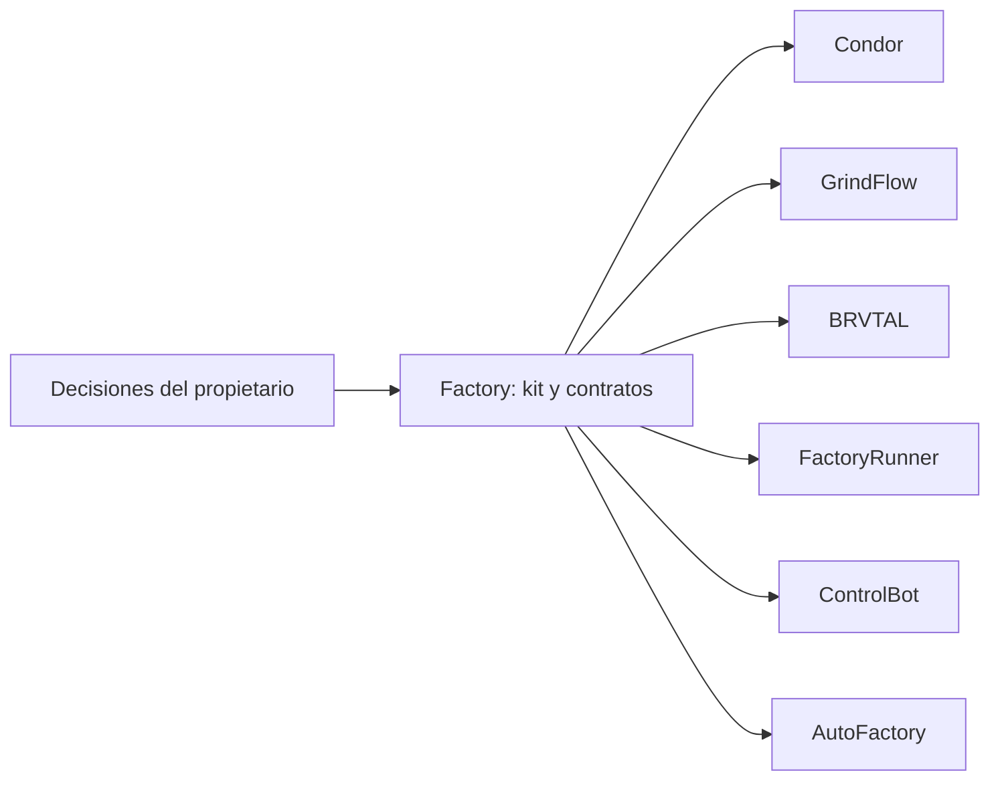

# 🏭 Factory: la fábrica de software de pl0n3r

**Factory reúne el kit de gobernanza, los flujos reutilizables y las herramientas de coordinación de los proyectos.** Aquí se define *cómo* se construye y valida software; cada producto define *qué* construye.

> Repositorio de **gobernanza y herramientas compartidas**, no una aplicación pública con un endpoint `/health` propio. Las señales operativas se consultan en sus fuentes.

## Operational Cockpit

[](https://github.com/pl0n3r/Factory/actions/workflows/ci.yml)
[](https://github.com/pl0n3r/Factory/releases)

[GitHub Actions](https://github.com/pl0n3r/Factory/actions) · [GitHub Releases](https://github.com/pl0n3r/Factory/releases) · [Orquestador de ControlBot](https://control.condorapp.com.co/)

Estas insignias consultan fuentes vivas al visualizar la página; no representan aprobación de despliegue ni requieren commits de actualización del README. Para el estado exacto de un PR, consulta sus checks y su SHA. Factory no anuncia aquí un estado de salud productiva que no pueda medir.

## Work Queue

- **NOW:** [Issues abiertos con estado y prioridad](https://github.com/pl0n3r/Factory/issues?q=is%3Aissue+is%3Aopen) y [PR en curso](https://github.com/pl0n3r/Factory/pulls).
- **NEXT:** [Hojas disponibles para agentes](https://github.com/pl0n3r/Factory/issues?q=is%3Aissue+is%3Aopen+label%3A%22estado%3A+disponible%22), sujetas a reserva V3 y dependencias.
- **LATER:** [Épicos y decisiones del roadmap](https://github.com/pl0n3r/Factory/issues) y [plan de agentes](PLAN-AGENTES.md).
- **BLOCKED:** [Issues bloqueados](https://github.com/pl0n3r/Factory/issues?q=is%3Aissue+is%3Aopen+label%3A%22estado%3A+bloqueado%22) con causa y condición de desbloqueo en cada Issue.

Esta vista resume; no duplica el Roadmap ni actúa como changelog.

## Qué hace el producto

Factory mantiene [workflows reutilizables](.github/workflows/), [scripts de coordinación y controles](scripts/), [roles de agentes](agentes/roles/), [plantilla de consumidores](template/) y [contratos documentados](docs/). Evita que los proyectos copien implementaciones de CI, seguridad y reservas que después puedan divergir.

La coordinación usa [reservas V3 con claims](docs/orquestador.md), aceptación ejecutable y revisiones de calidad. El kit llega a sus consumidores mediante versiones publicadas del canal [`@v1`](https://github.com/pl0n3r/Factory/releases), nunca solo porque cambie `main`.

## Arquitectura en 60 segundos



Factory conserva [gobernanza y políticas](AGENTES.md); [ControlBot](https://github.com/pl0n3r/ControlBot) es el *control plane*; [FactoryRunner](https://github.com/pl0n3r/FactoryRunner), el *execution plane*; [AutoFactory](https://github.com/pl0n3r/AutoFactory), una herramienta local. Condor, GrindFlow y BRVTAL son productos. La cola compartida **no mezcla sus responsabilidades arquitectónicas**.

## Stack e infraestructura

**Stack del kit:** Python 3 (biblioteca estándar), [GitHub Actions](.github/workflows/), configuración JSON/YAML, comprobaciones de seguridad y reusable workflows publicados por el canal protegido de [Releases](https://github.com/pl0n3r/Factory/releases).

Las aplicaciones, bases de datos, entornos de alojamiento y operaciones de producción pertenecen a cada consumidor. Factory ofrece contratos y verificadores, no presupone su infraestructura ni comparte credenciales entre proyectos. Ver [política operativa](PLAN-AGENTES.md) y [reglas técnicas](AGENTES.md).

## Ciclo de entrega

Issue con criterios verificables → `/tomar` y reserva V3 → rama `trabajo/issue-N` → PR → `Validar`, análisis de seguridad y revisión → squash permitido → [release protegida del kit](docs/release-bootstrap.md), **solo cuando exista autorización** → pruebas del consumidor.

Un PR fusionado no equivale a release; una release publicada no certifica por sí misma el estado productivo de los consumidores. Las puertas de datos reales, gasto, cambios irreversibles, despliegue y go-live siguen en [PLAN-AGENTES.md](PLAN-AGENTES.md).

## Calidad y seguridad

- [Aceptación ejecutable](docs/aceptacion-ejecutable.md), coordinación por archivos y pruebas `unittest` dentro de [CI](.github/workflows/ci.yml).
- [Control de decisiones y autorización](decisiones.yml) y [kill switch global](https://github.com/pl0n3r/Factory/issues/767).
- Checks `Validar`, CodeQL y SonarCloud consultables desde cada commit o PR; ningún resultado desconocido se convierte en éxito por escribirlo en este README.
- Actions con permisos mínimos, límites de eventos y revisiones; secretos, tokens y datos personales fuera de repositorios y logs.
- [Liberación automática de reservas](docs/liberacion-automatica-de-reservas.md): observación GET-only y activación mutante son fases distintas con puertas independientes.

## Roadmap y fuentes de verdad

- **Prioridades, tandas, reservas y autoridad:** [PLAN-AGENTES.md](PLAN-AGENTES.md).
- **Estructura técnica y límites del kit:** [AGENTES.md](AGENTES.md).
- **Decisiones vigentes:** [decisiones.yml](decisiones.yml).
- **Contrato de la portada:** [README Contract v2](docs/readme-contract.md) y [readme/contract.json](readme/contract.json).
- **Trabajo y aceptación:** [GitHub Issues](https://github.com/pl0n3r/Factory/issues) y [Pull Requests](https://github.com/pl0n3r/Factory/pulls).
- **Código entregado a consumidores:** [Releases oficiales](https://github.com/pl0n3r/Factory/releases).
- **Implementación y reglas de fases:** [Documentación técnica](docs/).

El README es una portada y una guía humana. No reemplaza ninguna de estas fuentes.

## Desarrollo local

Desde la raíz del repositorio, con Python 3:

```bash
python3 -m py_compile scripts/*.py
python3 -m unittest discover -s tests -p 'test_*.py'
```

Son comandos de verificación local; la evidencia de integración exige además el [workflow CI](.github/workflows/ci.yml) sobre el commit exacto.

## Mapa de la fábrica

- **[Factory](https://github.com/pl0n3r/Factory):** gobernanza, kit común, releases y aceptación.
- **[ControlBot](https://github.com/pl0n3r/ControlBot):** panel de control y decisiones con acceso restringido.
- **[FactoryRunner](https://github.com/pl0n3r/FactoryRunner):** plano de ejecución autónoma.
- **[AutoFactory](https://github.com/pl0n3r/AutoFactory):** extensión local/manual Chrome y Safari.
- **[Condor](https://github.com/pl0n3r/Condor):** producto de operaciones comerciales.
- **[GrindFlow](https://github.com/pl0n3r/GrindFlow):** SaaS para creadores y distribución.
- **[BRVTAL](https://github.com/pl0n3r/brvtal):** publicación web y panel editorial.

Los siete repositorios son elegibles para el despacho, pero esa elegibilidad no mezcla sus responsabilidades arquitectónicas. El seguimiento de eventos, liberaciones, versiones y decisiones se conserva en Issues, Actions y Releases en vez de duplicarse aquí.
